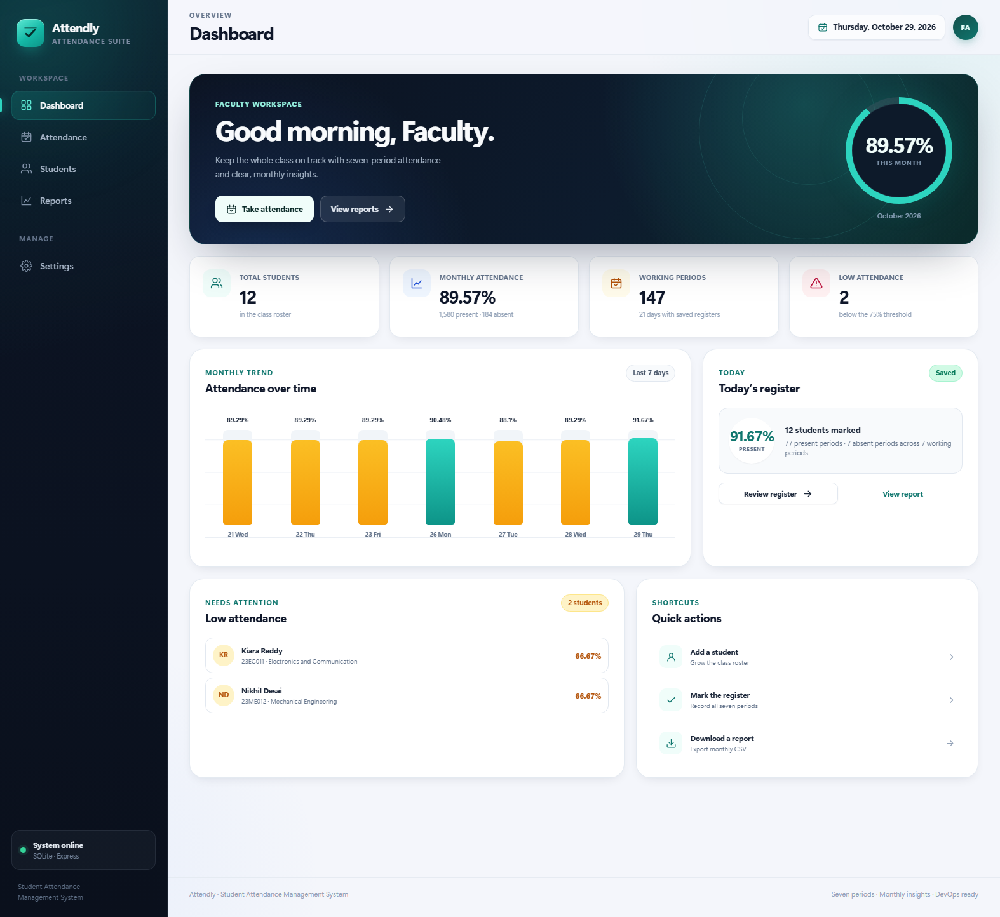
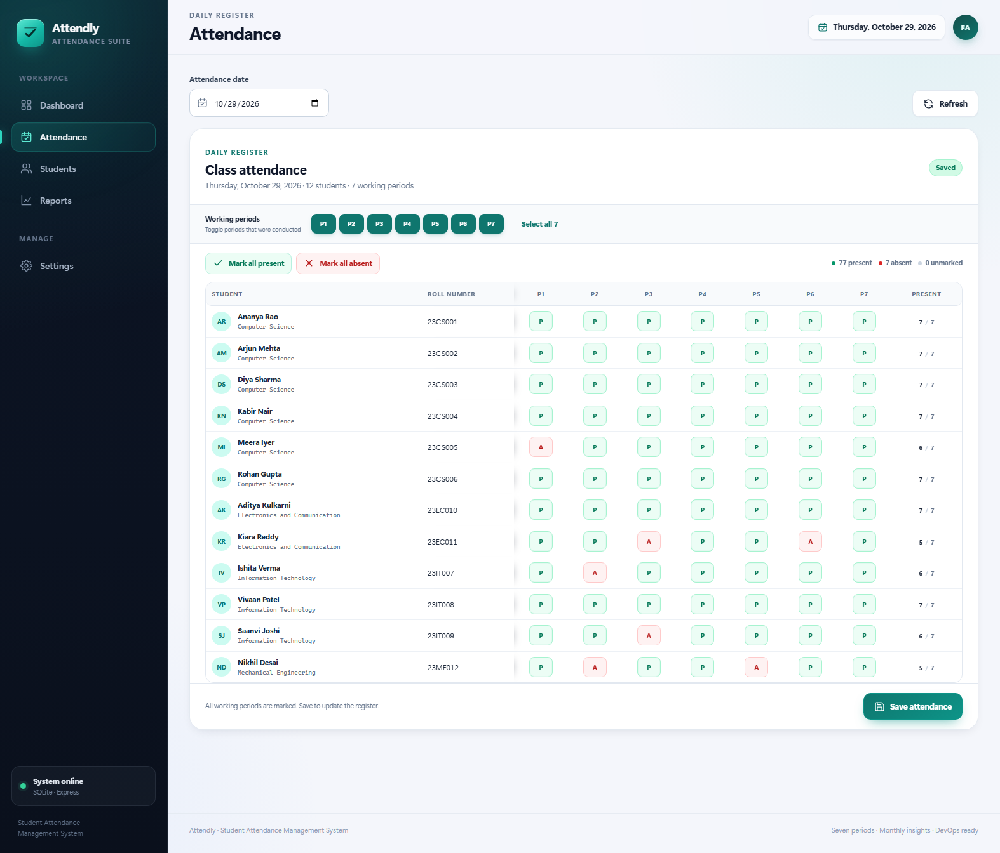
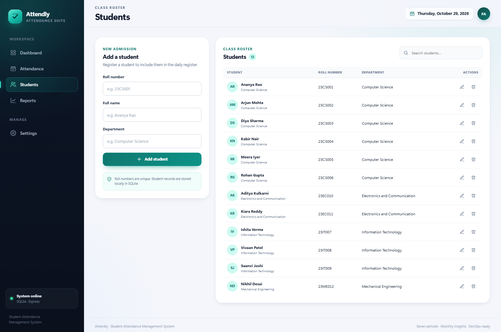
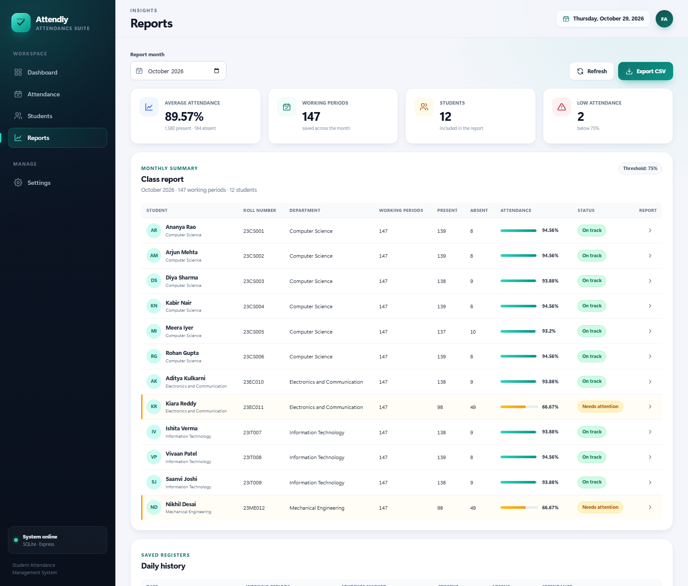
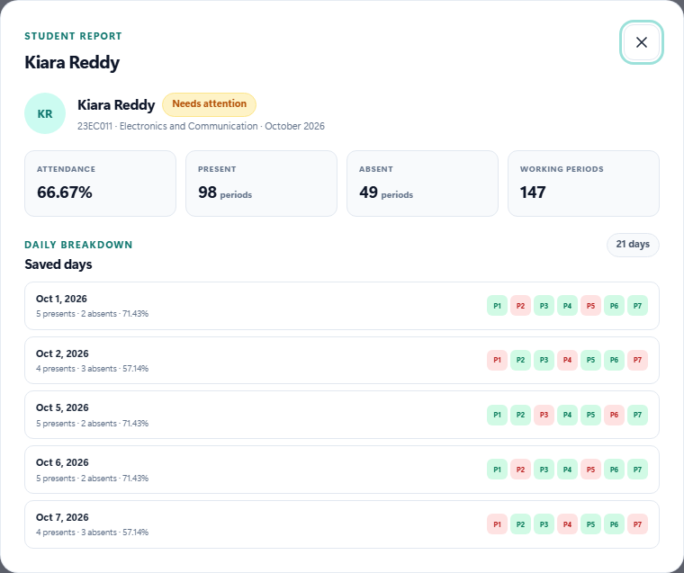
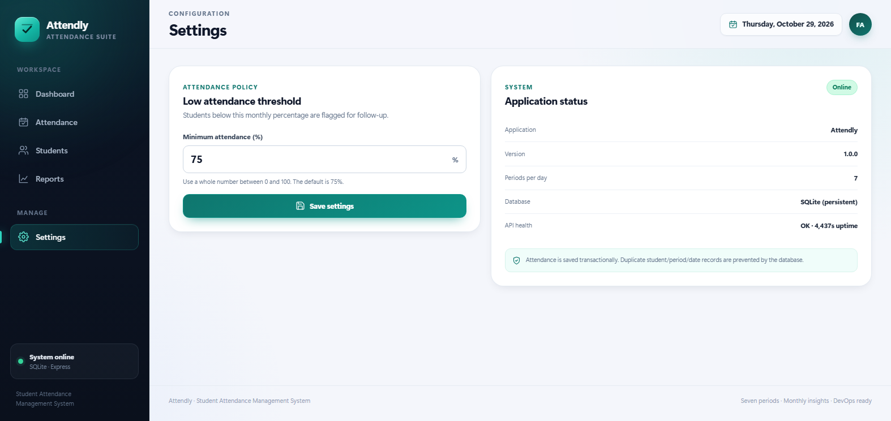

# Attendly — Student Attendance Management System

A complete, DevOps-ready attendance manager for a single class. It records **seven-period daily attendance**, stores every register **date by date**, prevents duplicate entries, supports corrections, calculates **monthly percentages**, flags **low attendance**, and exports class reports to **CSV**. The same application is packaged for local Node.js, Docker Compose, a Jenkins CI/CD pipeline, and Kubernetes (kind).



## Contents

- [Feature highlights](#feature-highlights)
- [Tech stack](#tech-stack)
- [Quick start](#quick-start)
- [How attendance works](#how-attendance-works)
- [Screenshots](#screenshots)
- [API reference](#api-reference)
- [Testing and verification](#testing-and-verification)
- [Docker](#docker)
- [Jenkins CI/CD](#jenkins-cicd)
- [Kubernetes with kind](#kubernetes-with-kind)
- [Configuration](#configuration)
- [Project structure](#project-structure)
- [Verification checklist](#verification-checklist)
- [Troubleshooting](#troubleshooting)
- [Security and limitations](#security-and-limitations)

## Feature highlights

- **Student management** — add, edit, delete, search, and list students with unique roll numbers.
- **Seven-period register** — mark every student for each period of a selected date.
- **Configurable working periods** — toggle the periods that were actually conducted (1–7).
- **Strict, transactional saves** — a save succeeds only when every current student is marked for every selected working period. Partial registers are rejected.
- **Date-wise storage** — each date has its own register, working periods, and history.
- **Corrections** — reload a saved date, change any status, and save again. Existing rows are updated rather than duplicated.
- **Duplicate prevention** — a database-level unique constraint on `(student_id, attendance_date, period)` protects the data even outside the UI.
- **Monthly class report** — per-student present/absent totals, working periods, percentage, status, and class-wide totals.
- **Individual student report** — monthly summary plus a day-by-day period breakdown.
- **Low-attendance detection** — a configurable threshold (default **75%**) flags students for follow-up on the dashboard and reports.
- **CSV export** — UTF-8 BOM for Excel, escaped fields, and formula-injection protection.
- **Dashboard** — live totals, monthly trend chart, today's register summary, low-attendance list, and quick actions.
- **Responsive UI** — keyboard-friendly navigation, dialogs, empty/loading states, and mobile layout.
- **Health endpoint** — `/api/health` is used by Docker, Compose, Kubernetes, and Jenkins smoke tests.
- **Persistence** — SQLite with WAL mode, foreign keys, and a persistent Docker volume/PVC.
- **CI/CD** — Jenkins pipeline for dependency install, validation, API tests, Docker build, and container smoke test.
- **Kubernetes** — namespace, PVC, deployment, NodePort service, and kind cluster configuration.

## Tech stack

| Layer | Technology |
| --- | --- |
| Runtime | Node.js 22+ (tested on Node 24.22.1 and Node 22 in Docker/Jenkins) |
| Web framework | Express 5 |
| Database | SQLite via `better-sqlite3` (WAL mode) |
| Frontend | Vanilla HTML, CSS, and JavaScript SPA |
| Security headers | Helmet; compression enabled |
| API tests | Node.js built-in test runner (`node:test`) |
| Browser tests | Selenium WebDriver + headless Chrome |
| Containers | Docker, Docker Compose |
| CI/CD | Jenkins LTS (JDK 17) in a custom controller image |
| Orchestration | Kubernetes via kind, Kustomize manifests |
| Reports | JSON API and CSV export |

## Quick start

### Prerequisites

- Node.js **20.11+** (Node 22 or 24 recommended)
- npm 10+
- Chrome/Chromium only for the Selenium end-to-end tests
- Docker Desktop only for the container, Jenkins, and Kubernetes workflows

### Run locally

```bash
npm install
npm run seed        # optional: 12 demo students + current month's registers
npm start
```

Open **http://localhost:3000**.

Useful commands:

```bash
npm run dev         # start with Node's watch mode
npm run seed -- --reset
npm run check       # syntax checks
npm test            # 22 API tests
npm run test:e2e    # 7 Selenium tests (requires Chrome)
npm run verify      # 12-check API smoke verification
npm run screenshots # regenerate documentation screenshots (requires a seeded running app)
```

The seed script generates demo attendance for **weekdays from the 1st of the current month through today**, with the final two students intentionally below the threshold. It refuses to modify a non-empty database unless `--reset` is supplied.

### Access

The application and the bundled Jenkins controller have **no login** (both are local demo services).

| Service | URL |
| --- | --- |
| Attendly | http://localhost:3000 |
| Jenkins | http://localhost:8080 |

> Jenkins authentication is disabled for this local demo, and the controller is bound to `127.0.0.1`. Do not expose port 8080 to a network. See [Security and limitations](#security-and-limitations).

## How attendance works

### Daily register

1. Choose a date.
2. Select the working periods that were conducted (all seven by default).
3. Mark each student **Present** or **Absent** for every selected period. Bulk actions are available for convenience.
4. Save.

The API validates the entire payload before writing:

- The date must be a real `YYYY-MM-DD` date.
- Between 1 and 7 unique working periods must be selected.
- Every student in the roster must appear exactly once for every working period.
- Student IDs must exist; statuses must be `Present` or `Absent`.
- Duplicate `(student, period)` entries are rejected.

The save runs in a single SQLite transaction. Existing rows for the same date/student/period are updated, so corrections are safe. Periods removed from the working-period selection are deleted for that date.

### Monthly calculation

For each student, the monthly denominator is the number of **recorded attendance rows** for that student in the selected month. In normal use this equals the number of working periods in the month, because the save rule requires a complete register. The class report also exposes the class-wide working-period count.

```
attendance % = present periods / recorded working periods × 100
low attendance = recorded working periods > 0 AND attendance % < threshold
```

A student with no records is shown with `0%` but is not flagged as low attendance until at least one period is recorded.

## Screenshots

| Dashboard | Daily attendance |
| --- | --- |
|  |  |

| Students | Monthly reports |
| --- | --- |
|  |  |

| Individual student report | Settings |
| --- | --- |
|  |  |

## API reference

Base URL: `http://localhost:3000`. All request and response bodies are JSON unless noted.

| Method | Endpoint | Purpose |
| --- | --- | --- |
| `GET` | `/api/health` | Health, version, uptime |
| `GET` | `/api/settings` | Threshold and periods per day |
| `PUT` | `/api/settings` | Update threshold (`attendance_threshold`) |
| `GET` | `/api/students?search=` | List/search students |
| `POST` | `/api/students` | Add a student |
| `PUT` | `/api/students/:id` | Update a student |
| `DELETE` | `/api/students/:id` | Delete a student (cascades attendance) |
| `GET` | `/api/attendance?date=YYYY-MM-DD` | Load a date's register and working periods |
| `POST` | `/api/attendance` | Save/correct a complete date register |
| `GET` | `/api/attendance/history?month=YYYY-MM` | Saved daily registers for a month |
| `GET` | `/api/reports/monthly?month=YYYY-MM` | Monthly class report |
| `GET` | `/api/reports/student/:id?month=YYYY-MM` | Individual student report |
| `GET` | `/api/reports/monthly.csv?month=YYYY-MM` | CSV export (attachment) |
| `GET` | `/api/dashboard?month=YYYY-MM&date=YYYY-MM-DD` | Aggregated dashboard data |

### Examples

```bash
# Health
curl http://localhost:3000/api/health

# Add a student
curl -X POST http://localhost:3000/api/students \
  -H "Content-Type: application/json" \
  -d '{"roll_number":"23CS013","name":"New Student","department":"Computer Science"}'

# Load a date
curl "http://localhost:3000/api/attendance?date=2026-10-29"

# Monthly report
curl "http://localhost:3000/api/reports/monthly?month=2026-10"

# CSV export
curl -o attendance-2026-10.csv \
  "http://localhost:3000/api/reports/monthly.csv?month=2026-10"
```

Save payload example (every student × every working period):

```json
{
  "date": "2026-10-29",
  "working_periods": [1, 2, 3, 4, 5, 6, 7],
  "attendance": [
    { "student_id": 1, "period": 1, "status": "Present" },
    { "student_id": 1, "period": 2, "status": "Absent" }
  ]
}
```

The example above is intentionally incomplete; the real request must include all 7 records for each student. The API returns `400` with a descriptive message if any record is missing.

### Error format

```json
{ "error": "Attendance is incomplete. Mark every student for every working period." }
```

Common status codes: `400` validation error, `404` missing student/endpoint, `409` duplicate roll number, `413` request body too large, `500` unexpected server error.

## Testing and verification

| Command | What it checks |
| --- | --- |
| `npm run check` | JavaScript syntax for server, API, database, reports, validation, frontend, and tests |
| `npm test` / `npm run test:api` | 22 API tests against a temporary SQLite database |
| `npm run test:e2e` | 7 Selenium/Chrome tests covering dashboard, students, attendance, reports, CSV, and settings |
| `npm run verify` | 12 end-to-end API smoke checks (health, students, duplicates, attendance, reports, CSV, settings) |
| `npm run test:all` | API tests followed by Selenium tests |

The Selenium tests start their own app instance with a temporary database on an ephemeral port, so they do not modify local or demo data. If Chrome is not on `PATH`, set `CHROME_BIN` to the Chrome executable.

### Manual verification checklist

- [ ] `npm run check` passes.
- [ ] `npm test` passes (22/22).
- [ ] `npm run test:e2e` passes (7/7).
- [ ] `npm run verify` passes (12/12).
- [ ] Add a student; the roster and dashboard update.
- [ ] Save a complete register; reload the date and confirm the values persist.
- [ ] Try saving with one period unmarked; the API/UI rejects it.
- [ ] Toggle a working period off, save, and confirm the period is removed for that date.
- [ ] Change a status and save again; no duplicate rows appear.
- [ ] Open the monthly report and an individual report.
- [ ] Export CSV; confirm it opens in Excel with correct columns and percentages.
- [ ] Change the threshold in Settings; confirm dashboard/report flags update.
- [ ] Restart the app/container; data remains.
- [ ] Jenkins pipeline completes all stages.
- [ ] Kubernetes pod is Ready and `http://localhost:30080` serves the app.

## Docker

### Build and run the app

```bash
docker build -t student-attendance:latest .

docker run -d \
  --name student-attendance \
  -p 3000:3000 \
  -v student-attendance-data:/app/data \
  student-attendance:latest
```

Open **http://localhost:3000**. The image runs as the non-root `node` user, exposes port 3000, and includes a container `HEALTHCHECK` against `/api/health`.

Seed demo data inside the container:

```bash
docker exec -e TZ=Asia/Kolkata student-attendance npm run seed -- --reset
```

The seed uses the container's local date. Containers default to UTC; replace `Asia/Kolkata` with your IANA timezone if you want the demo to run through your local "today".

### Docker Compose

`docker-compose.yml` defines:

- `app` — Attendly on port **3000**, persistent volume `student-attendance-data`, health check.
- `jenkins` — custom Jenkins controller on port **8080** (agent port **50000**), persistent volume `student-attendance-jenkins-home`, Docker socket, and the project mounted read-only at `/workspace`.

```bash
docker compose up -d --build
docker compose ps
```

Seed the Compose app volume (with an explicit timezone for the demo date):

```bash
docker compose exec -e TZ=Asia/Kolkata app npm run seed -- --reset
```

If a local Node process already uses port 3000, start only Jenkins:

```bash
docker compose up -d --build jenkins
```

Or change the app's host port in `docker-compose.yml` (for example `"3001:3000"`).

Stop and remove containers while keeping data:

```bash
docker compose down
```

Remove containers **and** volumes (destructive):

```bash
docker compose down -v
```

## Jenkins CI/CD

### What is included

- `jenkins/Dockerfile` — Jenkins LTS on JDK 17 with Git, Node.js 22, npm, Docker CLI, Buildx, Compose, and the required plugins.
- `jenkins/plugins.txt` — Git, pipeline, workflow, credentials, timestamps, and related plugins.
- `jenkins/init.groovy.d/01-security.groovy` — creates the local admin account and configures Jenkins.
- `jenkins/init.groovy.d/02-job.groovy` — creates/updates the `student-attendance-pipeline` job using `file:///workspace` and branch `*/main`.
- `Jenkinsfile` — the pipeline itself.

### Start Jenkins

```bash
docker build -t student-attendance-jenkins:latest ./jenkins
docker compose up -d jenkins
```

Wait for Jenkins to finish starting, then open **http://localhost:8080**. No login is required.

The project directory is mounted read-only at `/workspace`, and the Docker socket is mounted so the pipeline can build images on the host Docker engine. On first start, Jenkins creates the job automatically. The job polls the local Git repository every five minutes and can also be triggered manually.

### Pipeline stages

| Stage | Action |
| --- | --- |
| Environment | Prints Node, npm, Git, Docker CLI, and Docker server versions |
| Install dependencies | `npm ci` |
| Validate application | `npm run check` and `npm test` |
| Build Docker image | Builds `student-attendance:ci-<BUILD_NUMBER>` and `student-attendance:latest` |
| Container smoke test | Starts the image, waits for `/api/health`, creates a student, saves seven periods, and verifies the monthly report, then removes the container |

The pipeline uses `disableConcurrentBuilds()`, a 25-minute timeout, timestamps, and build/log retention. The smoke-test container is always removed in `post.always`.

### Trigger a build

From the UI: open the job and choose **Build Now**.

From the API, include a CSRF crumb:

```bash
CRUMB=$(curl -s \
  http://localhost:8080/crumbIssuer/api/json | sed -E 's/.*"crumb":"([^"]+)".*/\1/')

curl \
  -H "Jenkins-Crumb: $CRUMB" \
  -X POST http://localhost:8080/job/student-attendance-pipeline/build
```

Monitor the console:

```bash
curl \
  http://localhost:8080/job/student-attendance-pipeline/lastBuild/consoleText
```

### Important: commit to `main` first

The Jenkins job checks out `file:///workspace` on branch `*/main`. If the project is not a Git repository yet, initialize and commit it before building:

```bash
git init -b main
git add .
git commit -m "Initial Attendly implementation"
```

If you change the project later, commit the changes before triggering Jenkins, because Jenkins builds the committed revision rather than the working tree.

## Kubernetes with kind

The manifests in `k8s/` deploy a single replica with a PVC and a NodePort service:

| File | Purpose |
| --- | --- |
| `namespace.yaml` | `student-attendance` namespace |
| `pvc.yaml` | 1 GiB `ReadWriteOnce` volume for SQLite |
| `deployment.yaml` | Non-root app container, probes, resource limits, PVC mount |
| `service.yaml` | NodePort **30080** → container port 3000 |
| `kind-config.yaml` | Maps host port 30080 to the kind control-plane node |
| `kustomization.yaml` | Applies all resources together |

### Create the cluster and deploy

Prerequisites: Docker running, `kubectl`, and `kind`.

```bash
kind create cluster --name student-attendance --config k8s/kind-config.yaml
kind load docker-image student-attendance:latest --name student-attendance
kubectl apply -k k8s
kubectl -n student-attendance rollout status deployment/student-attendance --timeout=120s
kubectl -n student-attendance get pods,svc,pvc
```

Open **http://localhost:30080**.

Seed demo data inside the pod:

```bash
POD=$(kubectl -n student-attendance get pod -l app.kubernetes.io/name=student-attendance -o jsonpath='{.items[0].metadata.name}')
kubectl -n student-attendance exec "$POD" -- env TZ=Asia/Kolkata npm run seed -- --reset
```

The deployment uses `imagePullPolicy: IfNotPresent`, so the image loaded with `kind load` is used. After changing application code, rebuild the image and reload it:

```bash
docker build -t student-attendance:latest .
kind load docker-image student-attendance:latest --name student-attendance
kubectl -n student-attendance rollout restart deployment/student-attendance
```

### Verify persistence

Create a student or save attendance, delete the pod, and wait for the replacement:

```bash
kubectl -n student-attendance delete pod -l app.kubernetes.io/name=student-attendance
kubectl -n student-attendance rollout status deployment/student-attendance
```

The PVC keeps the SQLite database across pod replacement. The `Recreate` strategy avoids two pods writing to the same `ReadWriteOnce` volume during a rollout.

### Clean up

```bash
kubectl delete -k k8s
kind delete cluster --name student-attendance
```

## Configuration

| Variable | Default | Used by | Description |
| --- | --- | --- | --- |
| `PORT` | `3000` | App | HTTP port |
| `HOST` | `0.0.0.0` | App | Bind address |
| `DB_PATH` | `./data/attendance.db` | App, seed | SQLite file path; directories are created automatically |
| `NODE_ENV` | — | App | `production` enables static asset caching |
| `CHROME_BIN` | auto-detected | Selenium tests | Explicit Chrome executable |
| `APP_URL` | `http://127.0.0.1:3000` | Screenshot script | Running app used for screenshots |

Docker Compose reads `.env` automatically if you add one for local overrides.

## Project structure

```text
student_attende/
├── server.js                     # HTTP server, graceful shutdown
├── src/
│   ├── app.js                    # Express app, API routes, static serving
│   ├── database.js               # SQLite schema, settings helpers
│   ├── reports.js                # Monthly, daily, individual calculations
│   └── validation.js             # Input validation and constants
├── public/
│   ├── index.html                # SPA markup and icon sprite
│   ├── styles.css                # Responsive design system
│   ├── app.js                    # SPA state, API client, views, dialogs
│   └── favicon.svg
├── scripts/
│   ├── seed.js                   # Demo students and attendance
│   ├── verify.js                 # 12-check API smoke verifier
│   └── capture-screenshots.js    # Documentation screenshots
├── tests/
│   ├── api.test.js               # 22 API tests
│   └── e2e.test.js               # 7 Selenium tests
├── screenshots/                  # Documentation images
├── Dockerfile                    # Multi-stage production image
├── docker-compose.yml            # App + Jenkins
├── Jenkinsfile                   # CI/CD pipeline
├── jenkins/                      # Custom Jenkins image and init scripts
├── k8s/                          # Namespace, PVC, deployment, service, kind config
├── data/                         # Local SQLite database (gitignored)
├── package.json
└── README.md
```

## Verification checklist

The project was verified locally with the following results:

| Check | Result |
| --- | --- |
| Syntax checks (`npm run check`) | Pass |
| API tests (`npm test`) | 22/22 pass |
| Selenium tests (`npm run test:e2e`) | 7/7 pass |
| API smoke verification (`npm run verify`) | 12/12 pass |
| Adversarial API checks | 62/62 pass (validation, IDs, body limits, CSV, security headers) |
| Clean-room install (`npm ci` + checks/tests) | Pass |
| Docker image build | Pass (including a no-cache rebuild) |
| Container health, CRUD, reports, CSV, persistence | Pass |
| SQLite integrity and foreign keys | `integrity_check` ok, 0 FK violations |
| Jenkins image toolchain | Node 22, npm 10, Git 2.x, Docker CLI 27, Java 17 |
| Jenkins pipeline | See [docs/VERIFICATION.md](docs/VERIFICATION.md) for the latest run |
| Docker Compose app service | See [docs/VERIFICATION.md](docs/VERIFICATION.md) |
| Kubernetes/kind deployment | See [docs/VERIFICATION.md](docs/VERIFICATION.md) |

See [docs/VERIFICATION.md](docs/VERIFICATION.md) for commands, environment versions, and the recorded evidence.

## Troubleshooting

### Port 3000 is already in use

Stop the local Node process or run the container on another host port:

```bash
docker run -d --name student-attendance -p 3001:3000 \
  -v student-attendance-data:/app/data student-attendance:latest
```

Then open `http://localhost:3001`.

### Jenkins says the SCM checkout failed

The job expects a Git repository at `/workspace` with a `main` branch. Run:

```bash
git init -b main
git add .
git commit -m "Initial Attendly implementation"
```

Then trigger the job again. Check that the mount exists:

```bash
docker exec student-attendance-jenkins git -C /workspace status
```

### Jenkins cannot reach Docker

Confirm the socket is mounted and the container user can access it:

```bash
docker exec student-attendance-jenkins docker info
```

The Compose service runs Jenkins as `root` for local development so it can use the mounted Docker socket. Do not use this configuration for an internet-facing Jenkins.

### Jenkins plugin warnings

The Jenkins startup log may mention security advisories for bundled/installed plugins. Update plugins or pin newer versions for anything beyond a local demo. The included set is sufficient for this pipeline.

### Selenium cannot find Chrome

Install Chrome, or point the tests at an existing binary:

```powershell
$env:CHROME_BIN = "C:\Program Files\Google\Chrome\Application\chrome.exe"
npm run test:e2e
```

### kind cannot find the app image

Load the image into the cluster explicitly:

```bash
kind load docker-image student-attendance:latest --name student-attendance
kubectl -n student-attendance rollout restart deployment/student-attendance
```

### Reset the local database

```bash
npm run seed -- --reset
```

Or delete `data/attendance.db` while the app is stopped. Docker/Compose data lives in the named volume; remove it with `docker compose down -v` or `docker volume rm student-attendance-data`.

### Docker Desktop disk usage on Windows

Docker Desktop stores its WSL data under its configured data folder. If disk space is tight, move the Docker Desktop data directory through **Settings → Resources → Advanced** (or the Docker Desktop settings API) rather than deleting the VHDX files manually.

## Security and limitations

This is an educational/local deployment, not a hardened multi-tenant product.

- **No application authentication or authorization.** Anyone who can reach port 3000 can manage students and attendance. Put it behind a reverse proxy with authentication before exposing it.
- **No audit log.** Corrections overwrite the previous status and update `updated_at`; there is no per-change history.
- **Single class / single faculty workspace.** There is no academic-year, section, or multi-class model.
- **SQLite** is excellent for this single-instance workload but is not a distributed database. The Kubernetes deployment uses one replica and a `ReadWriteOnce` volume.
- **Jenkins has no authentication** in this local demo. It is bound to `127.0.0.1` and runs as root in Compose for Docker socket access. Never expose port 8080 to a network or use this setup in production.
- **CSV export** escapes cells and prefixes formula-like values to reduce spreadsheet injection risk, but always review exported files before opening untrusted data.
- **No HTTPS** in the bundled local setup. Terminate TLS at a reverse proxy or ingress for production use.
- **No GitHub remote is configured** in this local workspace. Add your own remote and push when authentication is available:

```bash
git remote add origin https://github.com/<your-account>/<your-repo>.git
git push -u origin main
```

## License

Created as an educational DevOps project. Add a license appropriate for your use case before distributing.
